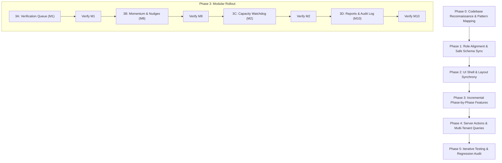

# Implementation Plan: Alumni Relations Officer Portal (`/officer`)

## Executive Summary
This document defines the end-to-end technical roadmap for building the dedicated **Alumni Relations Officer** (`alumni_relations_officer`) webpage and administrative dashboard in Alma. The portal resides at `src/app/(app)/officer/` as a sibling to the `/student` and `/mentor` spaces, enforcing multi-tenant isolation (`institutionId`), TOTP MFA access control, and platform privacy invariants.

---

## Mandatory Execution Directives & Working Rules

> [!IMPORTANT]
> The following rules govern all development on this feature without exception:

1. **Pre-Implementation Codebase Reconnaissance:** Before writing any code, the agent must thoroughly inspect the existing codebase—including layout primitives (`src/app/_components/app-shell.tsx`), navigation patterns in `src/app/(app)/student/` and `src/app/(app)/mentor/`, shared server actions, and Mongoose models—to ensure complete technical parity.
2. **Zero Regression & Full Synchronization:** The existing functionality of the student, alumni/mentor, and administrative flows must not be altered, broken, or degraded. All shared schemas, utilities, and components must maintain backward compatibility.
3. **Mandatory Clarification Gate:** If the agent encounters any ambiguity, architectural doubt, or missing specification detail, the agent **MUST pause and ask the user for clarification** rather than making unverified assumptions.
4. **Phase-by-Phase Execution with Verification:** Implementation must proceed sequentially through distinct phases. Each phase must be built, verified, and tested before moving to the next phase.
5. **UI & Layout Synchrony:** The new portal must visually and structurally match the existing Alma design language—using the warm stone/cream palette, typography hierarchy, custom SVG icons from [`src/app/_components/icons.tsx`](file:///D:/nextjs%20project/alma/Alumni-Mentorship-and-Career-Network/src/app/_components/icons.tsx), and card/badge styling from [`src/app/_components/app-shell.tsx`](file:///D:/nextjs%20project/alma/Alumni-Mentorship-and-Career-Network/src/app/_components/app-shell.tsx).

---

## Architecture & Data Flow

---

## Phased Implementation Roadmap

### Phase 0: Codebase Reconnaissance & Pattern Mapping
- **Objective:** Deeply inspect existing patterns to guarantee 100% synchrony.
- **Tasks:**
  - Audit existing layout structures in [`src/app/(app)/student/layout.tsx`](file:///D:/nextjs%20project/alma/Alumni-Mentorship-and-Career-Network/src/app/(app)/student/layout.tsx) and [`src/app/(app)/mentor/layout.tsx`](file:///D:/nextjs%20project/alma/Alumni-Mentorship-and-Career-Network/src/app/(app)/mentor/layout.tsx).
  - Inspect common UI components, colors, and fonts in [`src/app/globals.css`](file:///D:/nextjs%20project/alma/Alumni-Mentorship-and-Career-Network/src/app/globals.css) and [`src/app/_components/app-shell.tsx`](file:///D:/nextjs%20project/alma/Alumni-Mentorship-and-Career-Network/src/app/_components/app-shell.tsx).
  - Verify Mongoose models in [`src/lib/models/`](file:///D:/nextjs%20project/alma/Alumni-Mentorship-and-Career-Network/src/lib/models/) (`User.ts`, `Verification.ts`, `Mentorship.ts`, `Analytics.ts`) to ensure non-breaking additions.
- **Verification:** Confirm exact styling classes, token helpers, and session cookie validation signatures before authoring code.

---

### Phase 1: Authentication & Safe Role Alignment
- **Objective:** Enable `alumni_relations_officer` role safely without impacting `student`, `alumni`, or `administrator`.
- **Target Files:**
  - [`src/lib/models/User.ts`](file:///D:/nextjs%20project/alma/Alumni-Mentorship-and-Career-Network/src/lib/models/User.ts#L339): Safely add `"alumni_relations_officer"` to the `role` enum while preserving existing values and schema indices.
  - [`src/app/(app)/dashboard/page.tsx`](file:///D:/nextjs%20project/alma/Alumni-Mentorship-and-Career-Network/src/app/(app)/dashboard/page.tsx#L12-L21): Add role dispatch branch for `alumni_relations_officer` pointing to `/officer`, keeping all other role redirects untouched.
- **Phase Verification & Test:**
  - Verify existing student and alumni redirects continue functioning as expected.
  - Verify TypeScript compilation passes with strict typing.

---

### Phase 2: UI Shell & Layout Synchrony
- **Objective:** Create the officer portal skeleton matching Alma's stone/cream aesthetic.
- **Target Directory:** `src/app/(app)/officer/`
- **Files to Create:**
  - `layout.tsx`: Officer layout mirroring the student and mentor layouts, with breadcrumb header, institution indicator, role badge, and responsive navigation tabs.
  - `page.tsx`: Server Component entry point providing initial state, statistics counters, and tab hydration.
  - `loading.tsx`: Clean stone-palette skeleton loader matching existing route loaders.
  - `_components/officer-header.tsx`: Header component with institution badge, live metrics summary, and contextual actions.
- **Phase Verification & Test:**
  - Render `/officer` in browser/development server.
  - Verify visual alignment (typography, colors, borders) against `/student/dashboard` and `/mentor/dashboard`.

---

### Phase 3: Incremental Feature Rollout (Sub-Phases 3A – 3D)

Each sub-phase is built and independently tested:

#### 3A. Verification Review Queue (Module M1)
- **Component:** `src/app/(app)/officer/_components/verification-queue.tsx` & `document-modal.tsx`
- **Functionality:**
  - Tabular list of pending alumni verification requests with status filters (`pending`, `verified`, `rejected`).
  - Secure credential modal displaying graduation year, degree, and embedded pre-signed certificate viewer.
  - Action buttons: `Approve` and `Reject` (with mandatory reason selector).
- **Test & Validation:** Mock/submit verification request, approve it, verify status changes in MongoDB and directory visibility is enabled.

#### 3B. Relationship Momentum & Inactivity Watchdog (Module M8)
- **Component:** `src/app/(app)/officer/_components/relationship-momentum.tsx`
- **Functionality:**
  - Health scoring engine classifying active pairings:
    - 🟢 Healthy (Activity $\le 7$ days)
    - 🟡 At Risk (8–13 days)
    - 🔴 Stalled ($\ge 14$ days inactivity)
  - Action button: `Trigger Engagement Nudge` with a 7-day cooldown guard.
- **Test & Validation:** Verify health classification calculation against test timestamps, test nudge trigger, and confirm cooldown enforcement.

#### 3C. Mentor Capacity & Workload Balance (Module M2)
- **Component:** `src/app/(app)/officer/_components/capacity-watchdog.tsx`
- **Functionality:**
  - Mentor saturation visualization (`activeMentees / maxMentees`).
  - Alert badges for mentors at 100% capacity.
  - Emergency toggle to pause/resume incoming mentorship requests on behalf of mentors.
- **Test & Validation:** Toggle request intake for a mentor and confirm immediate update to `mentorCapacities.acceptingRequests`.

#### 3D. Program Accreditation Reports & Audit Trail (Module M10)
- **Component:** `src/app/(app)/officer/_components/audit-reports.tsx`
- **Functionality:**
  - Summary KPI cards (Active Mentorships, Completion Rate, Student Satisfaction).
  - One-click CSV export with personal email/phone numbers stripped.
  - Chronological audit log viewer displaying administrative decisions.
- **Test & Validation:** Trigger export and inspect generated CSV to verify zero alumni personal contact leakage.

---

### Phase 4: Server Actions & Multi-Tenant Data Layer
- **Target File:** `src/app/actions/officer.ts`
- **Actions Implemented:**
  - `getOfficerDashboardData()`: Scoped fetch for metrics, verifications, pairings, and capacities.
  - `decideVerification(requestId, decision, reason)`: Atomic update with audit logging.
  - `nudgeMentorship(mentorshipId)`: Engagement notification dispatch with cooldown check.
  - `toggleMentorAcceptance(mentorId, accepting)`: Capacity intake state mutation.
- **Security & Multi-Tenancy Enforcement:**
  - Every action validates session token and explicitly injects `{ institutionId: officer.institutionId }`.

---

### Phase 5: End-to-End Regression Testing & Quality Gate
- **Regression Testing:**
  - Test `/student/dashboard` and `/mentor/dashboard` to confirm zero unintended changes.
  - Test login and redirect flows for all roles (`student`, `alumni`, `administrator`, `alumni_relations_officer`).
- **Code Quality:**
  - Run `pnpm lint` and `pnpm build` (or `tsc --noEmit`) to verify zero TypeScript errors and zero lint violations.
- **Invariant Audit:**
  - Confirm alumni personal contact details are completely shielded from officer client payloads.
  - Confirm mentor capacity limits can never be exceeded.

---

## Escalation & Clarification Protocol

Whenever a decision point arises during implementation (such as custom institution styling, notification email templates, or database migration needs), the agent **must halt execution and ask the user for clarification** using clear, actionable questions before writing or modifying code.
